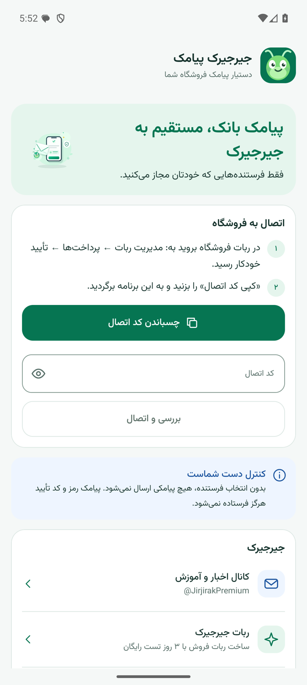
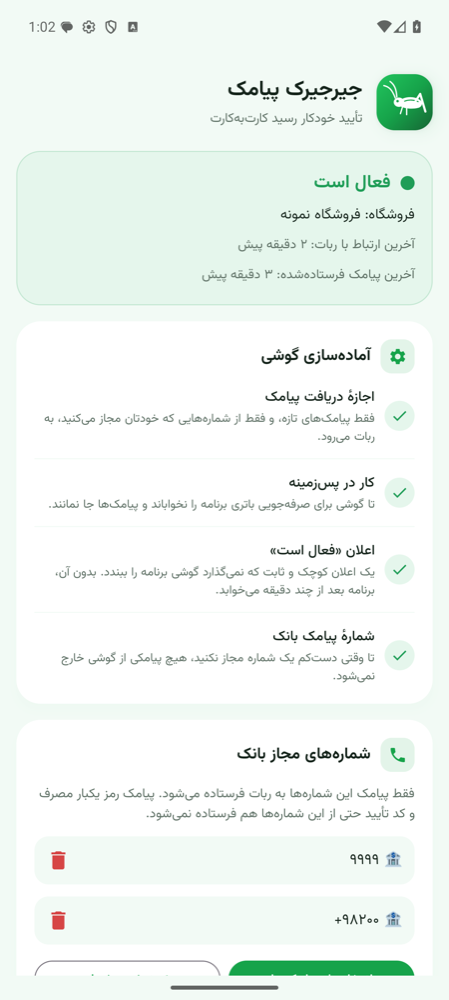
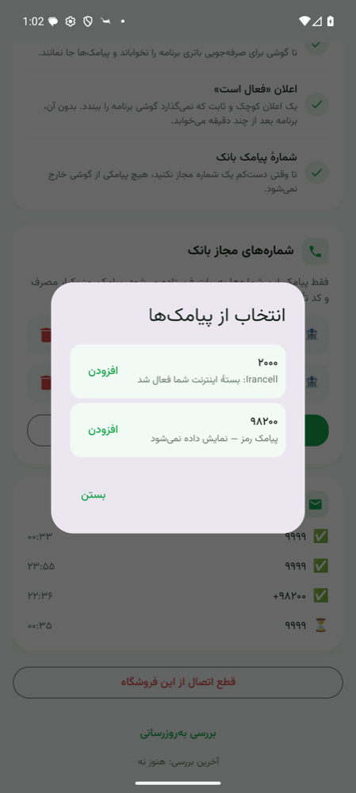
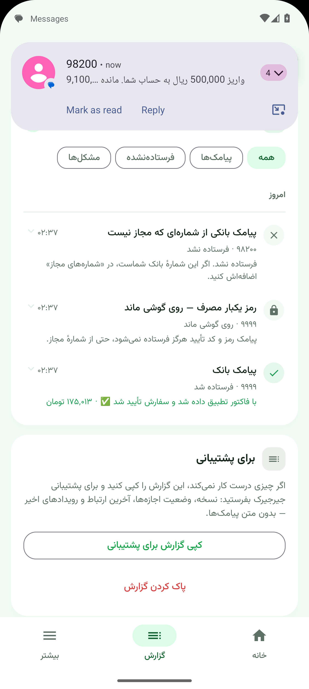

<div align="center">


# جیرجیرک پیامک

**تأیید خودکار رسید کارت‌به‌کارت، با پیامک بانک خودتان**

اپ همراهِ [ربات فروش جیرجیرک](https://t.me/JirjirakPremiumBot)

[](https://github.com/iamfarhad/JirJirakSMSReader/actions/workflows/build-apk.yml)
[](https://github.com/iamfarhad/JirJirakSMSReader/releases/latest/download/JirjirakSMS.apk)

</div>

<div dir="rtl">

## جیرجیرک چیست؟

**جیرجیرک** یک ربات فروش تلگرامی برای فروشندگان سرویس VPN است. هر فروشگاه ربات اختصاصی خودش را دارد، با کاتالوگ، کیف پول، درگاه‌های پرداخت، تست رایگان، نمایندگی و ده‌ها ابزار فروش دیگر. ربات به پنل‌های 3x-ui، مرزبان، PasarGuard، هیدیفای، WGDashboard و … وصل می‌شود و سرویس را خودکار می‌سازد و تحویل می‌دهد.

- 🎁 ساخت ربات با ۳ روز تست رایگان: [@JirjirakPremiumBot](https://t.me/JirjirakPremiumBot)
- 📢 اخبار و آموزش‌های جیرجیرک: [@JirjirakPremium](https://t.me/JirjirakPremium)

## این اپ چه می‌کند؟

بیشتر مشتری‌ها کارت‌به‌کارت پرداخت می‌کنند و فروشنده باید هر رسید را با چشم بررسی کند. ربات جیرجیرک می‌تواند این کار را خودکار انجام دهد: **پیامک واریز بانک** را با مبلغ دقیق فاکتور تطبیق می‌دهد و سفارش را تأیید می‌کند.

ربات از خودش نمی‌فهمد پولی به حساب شما آمده؛ پیامک بانک باید از گوشی شما به ربات برسد. این اپ همین کار را انجام می‌دهد، ساده و امن:

- **اتصال با یک کد:** در ربات «📋 کپی کد اتصال» را بزنید و در اپ «چسباندن کد اتصال». تمام.
- **فقط شماره‌هایی که خودتان مجاز می‌کنید:** تا وقتی شمارهٔ بانک را اضافه نکنید، هیچ پیامکی از گوشی خارج نمی‌شود. شماره را می‌توانید از میان پیامک‌های گوشی انتخاب کنید.
- **رمز یکبار مصرف هرگز فرستاده نمی‌شود:** پیامک رمز پویا و کد تأیید، حتی از شمارهٔ مجاز، روی گوشی می‌ماند.
- **گزارش هر پیامک:** هر پیامک بانک با نتیجه‌اش ثبت می‌شود — «با فاکتور تطبیق شد و سفارش تأیید شد»، «در انتظار بررسی مدیر»، «فاکتوری با این مبلغ نبود» — و هر پیامکی که روی گوشی ماند، با دلیلش. قطع و وصل شدن ارتباط هم همین‌جاست، و یک دکمه کل گزارش را برای پشتیبانی کپی می‌کند.
- **همیشه بیدار:** با یک اعلان کوچک ثابت در پس‌زمینه کار می‌کند تا گوشی آن را نخواباند. اگر گوشی قطع شود، ربات به شما خبر می‌دهد.
- **بدون اینترنت هم چیزی گم نمی‌شود:** پیامک‌ها روی گوشی صف می‌شوند و با وصل شدن اینترنت فرستاده می‌شوند.
- **اشتراک فروشگاه جلوی چشم:** سطح اشتراک جیرجیرک، تاریخ انقضا و تعداد رسیدهای در انتظار بررسی را از ربات می‌گیرد و نشان می‌دهد.
- **به‌روزرسانی خودکار:** نسخهٔ تازه را خودش پیدا می‌کند، در پس‌زمینه دانلود می‌کند و با یک اعلان خبر می‌دهد؛ شما فقط «نصب» را می‌زنید.

## تصاویر

<p align="center">
  
  
  
  
</p>

## نصب و راه‌اندازی

۱. آخرین نسخه را از [اینجا](https://github.com/iamfarhad/JirJirakSMSReader/releases/latest/download/JirjirakSMS.apk) یا از دکمهٔ «📲 دریافت اپ» داخل ربات بگیرید و روی **گوشی اندرویدی که سیم‌کارت حساب فروشگاه در آن است** نصب کنید.
۲. در ربات: **مدیریت ربات ← پرداخت‌ها ← تأیید خودکار رسید ← 📋 کپی کد اتصال**
۳. در اپ: **چسباندن کد اتصال**، بعد اجازهٔ پیامک و اعلان را بدهید.
۴. شمارهٔ پیامک بانک را از «انتخاب از پیامک‌ها» اضافه کنید.
۵. در گوشی‌های شیائومی، هواوی، اوپو، ویوو و سامسونگ «اجرای خودکار» را برای اپ روشن کنید (دکمه‌اش در اپ هست).

> اپ فقط روی اندروید ۷ به بالا کار می‌کند. روی آیفون ممکن نیست، چون iOS اجازهٔ خواندن پیامک به هیچ اپی نمی‌دهد.

## امنیت و حریم خصوصی

| چه چیزی | چه می‌شود |
|---|---|
| پیامک از شمارهٔ مجاز | فقط به ربات همان فروشگاهی فرستاده می‌شود که گوشی به آن وصل است |
| پیامک از شمارهٔ دیگر | هرگز فرستاده نمی‌شود |
| رمز یکبار مصرف و کد تأیید | هرگز فرستاده نمی‌شود، حتی از شمارهٔ مجاز |
| فهرست «انتخاب از پیامک‌ها» | فقط روی گوشی نمایش داده می‌شود و به جایی نمی‌رود |
| کد اتصال | اگر در ربات «تغییر آدرس» بزنید، کد قبلی باطل می‌شود |

قواعد این تصمیم‌ها در [`Rules.kt`](app/src/main/java/ir/jirjirak/sms/Rules.kt) است و با تست‌های [`RulesTest`](app/src/test/java/ir/jirjirak/sms/RulesTest.kt) قفل شده‌اند.

</div>

---

## For developers

Kotlin + Jetpack Compose, no third-party libraries. Persian RTL UI in Vazirmatn (bundled, OFL).

| Part | Role |
|---|---|
| `Rules` | What may leave the phone: pairing code, sender normalisation, OTP detection. Pure, unit-tested |
| `SmsReceiver` | Hears each new SMS (works with the app closed), applies `Rules`, queues it |
| `Store` | Pairing, allowed senders, suggestions, offline queue, the event log — one process-wide lock, and a Compose-observable revision so the screen redraws on every write |
| `Net` | `POST {ingest}` per SMS (the bot's verdict goes into the log); `POST {ingest}/ping` heartbeat (version, queue, allowed senders, SMS permission) — the reply carries the shop's subscription and the latest app version |
| `KeepAliveService` | Foreground service (`specialUse`) so vendor battery managers do not kill the app |
| `Beat` | Allow-while-idle alarm every 5 min: flush, ping, check for updates |
| `SyncJob` / `BootReceiver` | Network-bound retry job; re-arms everything after reboot or update |
| `Inbox` | «انتخاب از پیامک‌ها»: groups inbox senders on screen (never sent) |
| `Updates` / `SemVer` | Latest release from the bot's ping or the GitHub releases-page redirect (no API, no rate limit); DownloadManager + FileProvider hand the APK to the installer |
| `ui/` | `App` (tabs), `Home` (status, subscription, setup, senders), `Report` (events by Jalali day, diagnostics), `More` (update, links, connection) |

The bot side lives in the Jirjirak bot: `POST /api/bank-sms/{secret}` (ingest) and `…/ping` (heartbeat).

### Versioning

SemVer in [`version.properties`](version.properties) is the single source. `versionCode` is derived
(`MAJOR*1_000_000 + MINOR*1_000 + PATCH`), so every higher version installs over the lower one.
To release: bump `VERSION`, commit, then tag `v<VERSION>` — CI fails a tag that does not match.

### CI

[`.github/workflows/build-apk.yml`](.github/workflows/build-apk.yml) runs the unit tests and builds on
every push; a `v*` tag publishes the signed `JirjirakSMS.apk` to Releases. Signing uses the
`KEYSTORE_BASE64`, `STORE_PASSWORD`, `KEY_PASSWORD` and `KEY_ALIAS` secrets — there is no committed
fallback key, because an APK signed with a public key could be installed over a seller's copy of an
app that reads bank SMS.

```bash
./gradlew testDebugUnitTest assembleDebug   # JDK 17 or 21, Android SDK platform 36
```
